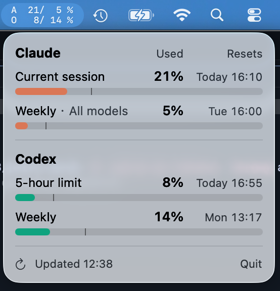

# Agents Usage 選單列小工具

一個 macOS 原生的選單列小 App,同時顯示 **Claude** 與 **Codex** 的**目前工作階段(5 小時)**與**每週限制**用量,不用再分別打開各家的用量頁面。

> **非官方工具。** Claude 的部分使用 Anthropic 未公開的端點,與 Anthropic、OpenAI 都沒有任何關係,之後隨時可能失效。使用前請閱讀下方「限制與風險」。



## 它做什麼

- 選單列顯示兩行、四個百分比,例如:

  ```
  A  21/  5 %
  O   8/ 14 %
  ```

  `A` 是 Claude(Anthropic),`O` 是 Codex(OpenAI);每行的兩個數字依序是**工作階段(5 小時)/ 每週**。查不到的欄位顯示 `–`。
- 所有百分比都是**已使用**的比例,不是剩餘額度。例如 `21%` 代表這個時段已用掉 21%,還剩 79%。
- 點開面板後,Claude 與 Codex 各一區,每個限制一列,由左到右是:名稱、`Used` 已使用百分比、`Resets` 重設時間。
  - 百分比依用量變色:50% 以上橘色、80% 以上紅色,未滿 50% 為一般文字色。
  - 進度條 Claude 為橘紅色、Codex 為綠色。
  - 重設時間以 24 小時制顯示,當天重設顯示 `Today 16:10`,其他日子顯示 `Tue 16:00`。滑鼠停在重設時間上,會顯示距離重設的剩餘時間(例如 `3h 54m left`);只有時間用「剩餘」表示,用量一律是已使用。
  - 進度條上的**細標線**,代表這個時段已經過去的時間;滑鼠停在進度條上會顯示說明。用量在標線前面,代表消耗得比時間快。
- 左下角 `↻` 手動重新整理,旁邊顯示最後更新時間,右下角 `Quit` 結束。
- 沒有 Dock 圖示,只存在於選單列。

## 需求

- macOS 13 (Ventura) 或更新版本
- Xcode 命令列工具(沒有的話執行 `xcode-select --install`)
- 已安裝並登入 **Claude Code**(小工具讀取它存放的登入憑證)
- 已安裝並以 ChatGPT 帳號登入 **Codex CLI**(`codex` 需在 `PATH`、`/opt/homebrew/bin`、`/usr/local/bin` 或 `~/.local/bin` 其中之一)
- 付費方案(Claude Pro、Max、Team 等;ChatGPT 對應方案)。有每個時段限額的方案才有資料可顯示

Claude 與 Codex 各自獨立:只裝其中一個也能用,另一區會顯示錯誤訊息。

## 安裝與執行

把 `AgentsUsageApp.swift` 與 `build.sh` 放在同一個資料夾,然後:

```bash
bash build.sh
open AgentsUsage.app
```

`build.sh` 會用 `swiftc` 編譯並產生 `AgentsUsage.app`,不需要開 Xcode 專案,也會做 ad-hoc 簽署,讓 macOS 能執行本機建置的 App。

### 第一次執行

macOS 會跳出鑰匙圈視窗,詢問是否允許 `security` 讀取 Claude Code 的憑證。選「**始終允許**」,之後就不會再問。

### 確認數字正確

第一次請對照 Claude 的 Settings > Usage 與 Codex 的用量頁面,兩邊數字應該一致。不一致時,可能是端點或協定格式已變更,請閱讀 `AgentsUsageApp.swift` 的欄位解析排查。

### 開機自動啟動

把 `AgentsUsage.app` 放進「應用程式」資料夾,再到 系統設定 > 一般 > 登入項目 加入。

### 解除安裝

結束 App(選單裡的「結束」),刪除 `AgentsUsage.app` 即可。它沒有在其他地方寫入任何資料。

## 運作原理

這個 App 只查詢**用量額度**,不會呼叫任何 AI 模型,也不指定或使用特定 model。

### Claude

1. 從鑰匙圈(服務名稱 `Claude Code-credentials`)讀取 Claude Code 的 OAuth 登入憑證。找不到時退回讀取 `~/.claude/.credentials.json`。
2. 以該憑證向 `https://api.anthropic.com/api/oauth/usage` 發送一個 GET 請求。
3. 解析回應中的 `five_hour`、`seven_day`(以及有的話 `seven_day_opus`、`seven_day_sonnet`),每項包含 `utilization`(已使用百分比)與 `resets_at`(重設時間)。有分 Opus、Sonnet 各自額度的方案,會多顯示對應的列。

### Codex

1. 在 `PATH` 與常見安裝位置尋找 `codex` 執行檔。
2. 啟動子行程 `codex app-server --listen stdio://`,透過 stdin/stdout 傳送 JSON-RPC。
3. 依序送出 `initialize`、`initialized`、`account/rateLimits/read`,讀回 `primary` 與 `secondary` 兩個視窗,每個包含 `usedPercent`(已使用百分比)、`windowDurationMins` 與 `resetsAt`。視窗長度 300 分鐘顯示為 `5-hour limit`、10080 分鐘顯示為 `Weekly`。
4. 這條路不經過 token,完全依賴 Codex CLI 自己的 ChatGPT 登入狀態;子行程超過 12 秒會被強制結束。

兩邊的結果顯示在選單列與彈出面板。

### 更新頻率

- Claude 與 Codex **每 5 分鐘**一起查詢一次,啟動時也會立刻查詢一次。
- 手動重新整理有 15 秒的間隔限制。
- 滑鼠停在重設時間上看到的「剩餘時間」,以及進度條上的標線位置,每 30 秒用本機時鐘重算,**不會連網**。
- Mac 睡眠期間計時器暫停,醒來後恢復。

要調整頻率,修改 `AgentsUsageApp.swift` 中 `UsageModel` 的 `init()`:

```swift
timer = Timer.scheduledTimer(withTimeInterval: 300, repeats: true) { ... }
```

把 `300`(秒)改掉後重新執行 `bash build.sh`。不建議設得比 60 秒更短,端點是未公開的,太頻繁可能被限流(HTTP 429)。

## 隱私與安全

- Claude 的憑證只用來向 `api.anthropic.com` 發送查詢請求,不會寫入磁碟、不會記錄、不會顯示在畫面上。
- 程式只有三項對外行為:讀取 Claude 憑證、發送一個 Claude 用量查詢請求、啟動本機 `codex app-server` 查詢 Codex 額度(連網由 Codex CLI 自己處理)。沒有其他連線,沒有分析或回報。
- 這是你自己編譯的程式,不會自動更新。想確認行為,直接閱讀 `AgentsUsageApp.swift`,檔案不長。
- 這些查詢是讀取用量,不是呼叫模型,預期不會消耗你的額度。這一點沒有經過官方確認,建議自己觀察一陣子。

## 限制與風險

- **端點未公開。** `/api/oauth/usage` 沒有官方文件,Anthropic 可能隨時更動或移除,屆時小工具會顯示錯誤或失效。
- **依賴 Claude Code 的登入狀態。** 憑證過期時,需要開一次 Claude Code 讓它更新,小工具本身不會更新憑證。
- **Codex 依賴 Codex CLI 的 `app-server` 協定。** 這個協定不是穩定的公開介面,CLI 升級後方法名稱或欄位可能改變,屆時 Codex 區會顯示錯誤。
- **使用條款不確定。** 在 Claude Code 之外使用它的憑證是否被允許,並沒有明確的官方說法。正式依賴前請自行確認 Anthropic 的使用條款。
- Claude 回應格式是依公開的第三方資料推測的。若你的方案回傳的欄位不同,請調整 `AgentsUsageApp.swift` 的欄位對應。

## 疑難排解

| 狀況 | 處理方式 |
| --- | --- |
| 找不到登入憑證 | 先在終端機執行 `claude` 並登入。若鑰匙圈視窗被你按了「拒絕」,到「鑰匙圈存取」找到 Claude Code-credentials 項目,重新允許 `security`。 |
| 憑證已過期 | 開啟一次 Claude Code,讓它自動更新憑證,再按重新整理。 |
| Codex 區顯示 `Codex CLI was not found.` | 確認已安裝 Codex CLI,且 `codex` 在 `PATH`、`/opt/homebrew/bin`、`/usr/local/bin` 或 `~/.local/bin` 其中之一。 |
| Codex 區顯示 `Could not fetch Codex limits.` | 在終端機執行 `codex` 並以 ChatGPT 帳號登入;若 CLI 剛升級,可能是 `app-server` 協定變更。 |
| HTTP 401 / 403 | 憑證被拒絕。重新登入 Claude Code。 |
| HTTP 429 | 查詢過於頻繁,稍後會自動重試。 |
| 其他 HTTP 錯誤或「格式不符」 | 端點可能已變更。請調整 `AgentsUsageApp.swift` 的欄位解析。 |
| 編譯失敗 | 確認 macOS 13+ 與 Xcode 命令列工具;把錯誤訊息貼出來排查。 |
| 選單列沒有出現 | 確認 App 正在執行(活動監視器搜尋 AgentsUsage);選單列空間不足時,圖示可能被擠到螢幕缺口後面。 |

## 檔案

| 檔案 | 說明 |
| --- | --- |
| `AgentsUsageApp.swift` | 全部程式碼:Claude 憑證與 API 請求、Codex app-server 查詢、資料模型、介面 |
| `build.sh` | 編譯並打包成 `AgentsUsage.app` 的腳本 |
| `README.md` | 本文件 |
| `docs/screenshot.png` | README 使用的面板截圖 |

`AgentsUsage.app` 是編譯產物,已列在 `.gitignore`,不會進版控。

## 技術備註

- SwiftUI `MenuBarExtra`(`.window` 樣式),需要 macOS 13+。
- `LSUIElement` 設為 true,所以沒有 Dock 圖示。
- 讀取 Keychain 是透過 `/usr/bin/security` 命令列工具,而不是直接呼叫 Keychain API,這樣重新編譯後不會因為簽章改變而重複詢問授權。
- 重設時間的小數秒會先去除再解析,避免 `ISO8601DateFormatter` 對微秒的相容問題。

## 免責聲明

本工具為個人使用的非官方實作,不隸屬於 Anthropic 或 OpenAI,也不受其背書。風險自負。
