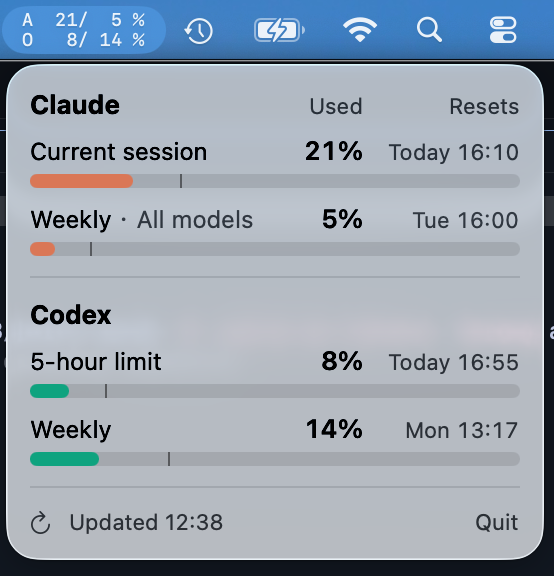

# Agents Usage 選單列小工具

[English](README.md) | **繁體中文**

一個 macOS 選單列小 App,同時顯示 **Claude** 與 **Codex** 的**工作階段(5 小時)**與**每週**用量,不用再分別打開各家的用量頁面。

> **非官方工具,不隸屬於 Anthropic 或 OpenAI。** 它依賴未公開的介面,之後隨時可能失效,風險自負。詳見 [隱私與風險](docs/privacy-and-risks.md)。



## 怎麼看這個畫面

**選單列**(右上角)有兩行、四個數字:

```
A  21/  5 %      ← Claude:5 小時 / 每週
O   8/ 14 %      ← Codex:5 小時 / 每週
```

**點開面板**,Claude 與 Codex 各一區,每個限制一列:

| 欄位 | 意思 |
| --- | --- |
| 名稱 | 例如 `Current session`、`Weekly · All models`、`5-hour limit` |
| `Used` | 這個時段**已使用**的百分比(不是剩餘額度),50% 以上橘色、80% 以上紅色 |
| `Resets` | 重設時間,例如 `Today 16:10`、`Tue 16:00`;滑鼠停上去會顯示剩餘時間 |

進度條上的**細標線**是這個時段已經過去的時間。進度條填色(用量)超過標線,代表消耗得比時間快。

左下角 `↻` 手動重新整理,旁邊是最後更新時間;右下角 `Quit` 結束。App 沒有 Dock 圖示,只存在於選單列。

## 需求

- macOS 13 (Ventura) 或更新版本,以及 Xcode 命令列工具(`xcode-select --install`)
- 已安裝並登入 **Claude Code** 與 **Codex CLI**(ChatGPT 帳號)。兩者各自獨立,只裝一個也能用,另一區會顯示錯誤
- 有時段限額的付費方案

## 快速開始

```bash
bash build.sh
open AgentsUsage.app
```

第一次執行時,macOS 會詢問是否允許讀取 Claude Code 的憑證,請選「**始終允許**」。

## 更多說明

- [安裝細節](docs/install.md):開機自動啟動、解除安裝
- [運作原理](docs/how-it-works.md):Claude 與 Codex 如何取得用量、更新頻率、技術備註
- [疑難排解](docs/troubleshooting.md)
- [隱私與風險](docs/privacy-and-risks.md)
